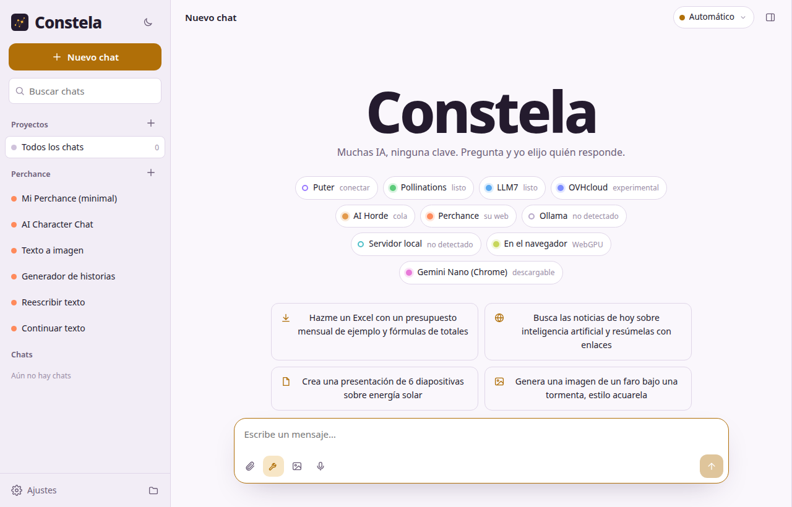
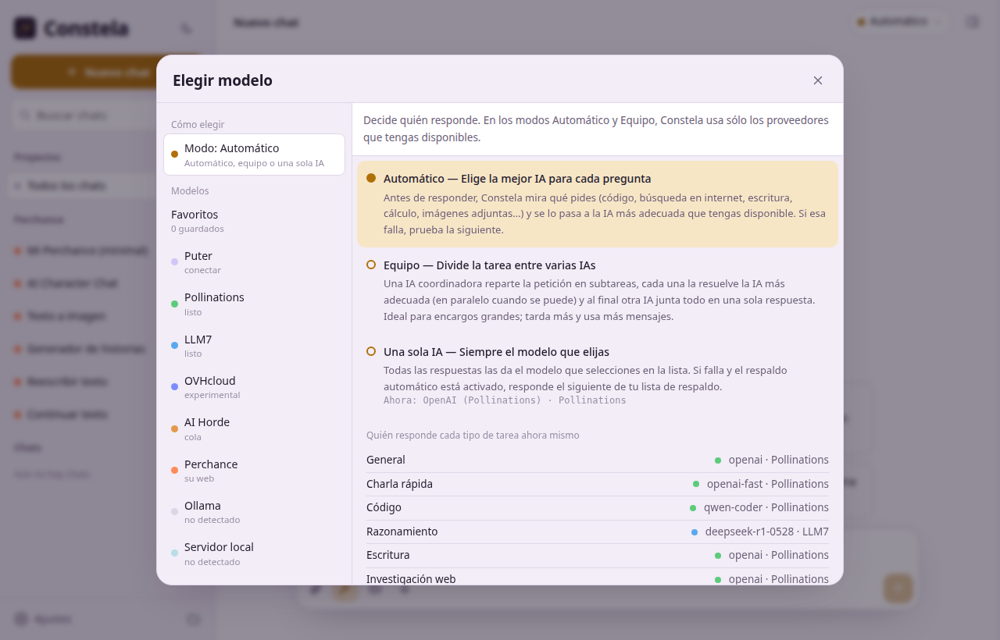
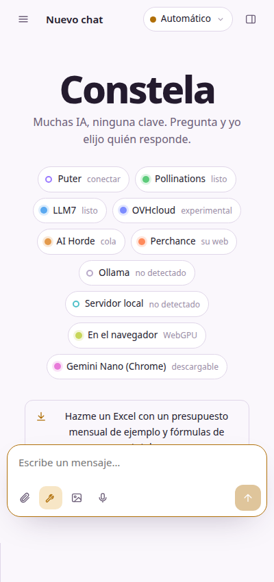

# Constela

**Muchas IA, ninguna clave.**

Un solo chat que reúne modelos de inteligencia artificial **gratuitos** de la nube, de tu PC y de tu navegador — **sin pedirte ninguna API key**. Pregunta y Constela elige qué IA responde; si una falla, responde la siguiente.

🌐 **[Abrir la web](https://yottomtnz.github.io/Constela/app/)** · 📦 **[Descargar (última versión)](https://github.com/YottoMtnz/Constela/releases/latest)**

## ⬇️ Descargas

| Plataforma | Archivo | |
|---|---|---|
| 🤖 **Android** | `Constela-Android.apk` | [Descargar](https://github.com/YottoMtnz/Constela/releases/latest/download/Constela-Android.apk) |
| 🪟 **Windows (instalador)** | `Constela-Setup-1.0.0.exe` | [Descargar](https://github.com/YottoMtnz/Constela/releases/latest/download/Constela-Setup-1.0.0.exe) |
| 🎒 **Windows (portable)** | `Constela-Portable-1.0.0.exe` | [Descargar](https://github.com/YottoMtnz/Constela/releases/latest/download/Constela-Portable-1.0.0.exe) |
| 🌐 **Web** | Sin instalar nada | [Acceder](https://yottomtnz.github.io/Constela/app/) |

> En Windows, SmartScreen puede avisar la primera vez: **Más información → Ejecutar de todas formas**.
> La página de presentación está en la raíz del sitio: [yottomtnz.github.io/Constela](https://yottomtnz.github.io/Constela/).

## 📸 Capturas

| Pantalla principal | Elegir modelo |
|---|---|
|  |  |

## ✨ Qué hace

- **Tres modos de trabajo** (botón de arriba a la derecha):
  - **Automático**: mira qué pides (código, búsqueda en internet, escritura, cálculo, documentos, imágenes…) y se lo pasa a la IA más adecuada que tengas disponible.
  - **Equipo**: una IA coordinadora divide el encargo en subtareas, cada una la resuelve la IA más adecuada (dos a la vez) y al final otra IA junta todo en una sola respuesta.
  - **Una sola IA**: siempre el modelo que elijas.
  - En los tres modos, si una IA falla o llega a su límite, responde la siguiente (respaldo automático).
- **Archivos de verdad**: Word (.docx), PDF, Excel (.xlsx, con fórmulas y varias hojas), PowerPoint (.pptx), páginas web, código, CSV… con vista previa y descarga. Varios archivos se bajan juntos en .zip.
- **Imágenes**: las IAs pueden dibujar (Pollinations, Puter o Perchance), y hay un «modo imagen» para dibujar directamente.
- **Herramientas** que las IAs usan solas: buscar en la web, leer páginas, Wikipedia, ejecutar JavaScript y Python (con gráficos y archivos de salida), calculadora, fecha y hora, clima y memoria.
- **Adjuntos**: PDF, Word, Excel, PowerPoint, imágenes, código y texto.
- Proyectos con instrucciones propias, búsqueda de chats, edición de mensajes, lectura en voz alta, dictado, tema claro/oscuro y copias de seguridad.

## 🔌 Proveedores (ninguno pide API key)

| Proveedor | Qué necesitas | Notas |
|---|---|---|
| **Pollinations** | Nada | Anónimo. Si te pasas de ritmo, Constela espera y reintenta. |
| **LLM7** | Nada | Anónimo. Mensajes largos se recortan solos. |
| **Puter** | Una cuenta gratis de Puter | Más de 400 modelos: GPT, Claude, Gemini, Grok, DeepSeek… |
| **Ollama** | Ollama en tu PC | Modelos locales y los `:cloud` de Ollama. |
| **Servidor local** | LM Studio, llama.cpp, Jan… | Cualquier servidor compatible con OpenAI. |
| **AI Horde** | Nada | Red comunitaria; va por cola y puede tardar. |
| **Perchance** | Nada | Dentro del chat con un «puente», o en su web. |
| **WebLLM** | Chrome/Edge con GPU | El modelo vive en tu navegador y funciona sin internet. |
| **Gemini Nano** | Chrome con IA integrada | Solo si tu Chrome la ofrece. |
| **OVHcloud** | Nada | Experimental. |

> Estos servicios son gratuitos y de terceros: pueden cambiar sus límites o dejar de funcionar. Por eso existe el respaldo automático.

## 🔒 Tus datos

Todo (chats, archivos, ajustes, memoria) se guarda **solo en tu dispositivo**. Usa *Ajustes → Datos y memoria → Exportar todo* para hacer copias. Los mensajes viajan únicamente al proveedor de IA que responde en cada caso.

## 🛠️ Cómo se publica

El mismo código vive en tres casas: la **web** (carpeta `www/`, con la presentación en la raíz y la app en `www/app/`), **Windows** (Electron, carpeta `desktop/`) y **Android** (Capacitor, carpeta `mobile/`). GitHub Actions compila las tres automáticamente con cada cambio, y al crear una etiqueta `vX.Y.Z` adjunta los instaladores a la Release.

---

*Hecha por **Fraudy Martinez Madruga*** · [Más proyectos](https://github.com/YottoMtnz)

## 🌐 In English

**Constela — Many AIs, zero API keys.** One chat that brings together free AI models from the cloud, your PC and your browser. Ask, and Constela picks which AI answers; if one fails, the next takes over. It creates real files (Word, PDF, Excel, PowerPoint), draws images, uses its own tools (web search, Wikipedia, Python…), and keeps all your data on your device. Available on the [web](https://yottomtnz.github.io/Constela/app/), as a Windows program (installer or portable) and as an Android app — [download the latest release](https://github.com/YottoMtnz/Constela/releases/latest).
